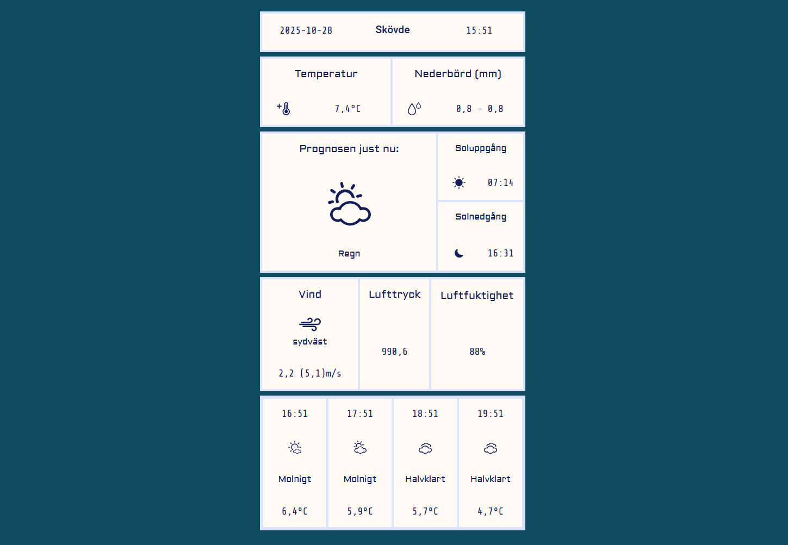

# Weather Station

## Description

Weather Station is a static weather application developed using the Blazor framework, and written in C#, HTML and CSS. The weather information is fetched upon application start from the Swedish Meteorological and Hydrological Institute Open Data API, with the exception of the sunrise and sunset information that is provided by SunriseSunset.io. The icons are provided by QWeather. 

## Table of Contents

- [Description](#-description)
- [Technologies](#-technologies)
- [Installation](#-installation)
- [Project Structure](#-project-structure)

## Technologies

- [C#](https://learn.microsoft.com/en-us/dotnet/csharp/?icid=SSM_AS_CSHARP)
- [Blazor Framework](https://dotnet.microsoft.com/en-us/apps/aspnet/web-apps/blazor)
- [SMHI Open Data API](https://opendata.smhi.se/)
- [SunriseSunset.io API](https://sunrisesunset.io/api/)
- [QWeather Icons Library](https://icons.qweather.com/en/)

## Installation

To run a Blazor program which is a .NET application, it is recommended to do this with either Visual Studio, or Visual Studio Code, and have .NET SDK as well as C# Dev Kit. Follow [these](https://dotnet.microsoft.com/en-us/learn/aspnet/blazor-tutorial/install) instructions to aquire them all.

To test the application, download the repository code and [run it](https://dotnet.microsoft.com/en-us/learn/aspnet/blazor-tutorial/run).

The base location is hardcoded for Skövde, Sweden, but you can easily switch it by changing to your desired latitude and longtitude in the HTTP client request of the Weather.razor file. Note, however, that the WeatherModel.cs is coded to work specifically with SMHI Open Data API and SunriseSunset.io API endpoints, so further adjustments need to be made if you would like to use a location outside of the Nordics.

The screenshot below shows what the application should look like:



## Project Structure

```
WeatherStation
    ├───bin
    │   ├───Debug
    │   │   └───net9.0
    │   └───Release
    │       └───net9.0
    ├───Components
    │   ├───Layout
    │   └───Pages
    ├───Models
    ├───obj
    │   ├───Debug
    │   │   └───net9.0
    │   │       ├───compressed
    │   │       ├───ref
    │   │       ├───refint
    │   │       ├───scopedcss
    │   │       │   ├───bundle
    │   │       │   ├───Components
    │   │       │   │   └───Layout
    │   │       │   └───projectbundle
    │   │       └───staticwebassets
    │   └───Release
    │       └───net9.0
    │           ├───ref
    │           └───refint
    ├───Properties
    └───wwwroot
        └───lib
            └───bootstrap
                ├───dist
                │   ├───css
                │   └───js
                └───fonts
```


